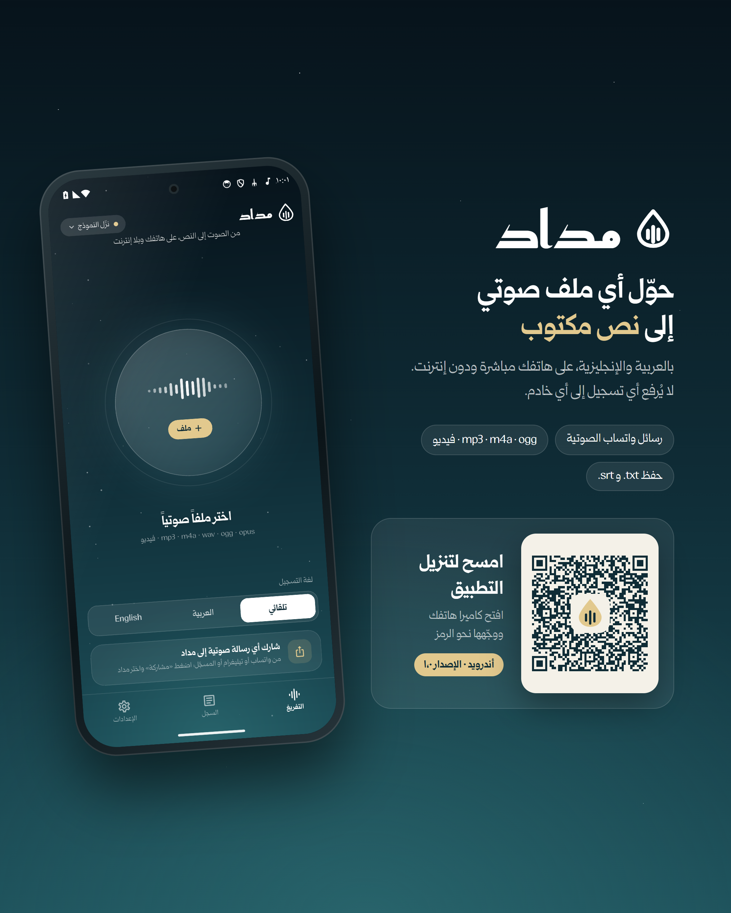

# مداد — Midad

تحويل الملفات الصوتية إلى نص بالعربية والإنجليزية، على الهاتف ودون إنترنت.

## التنزيل
**[⬇ تنزيل أحدث إصدار (Midad.apk)](https://github.com/AbdullahAlHallak/midad-releases/releases/latest/download/Midad.apk)**

للهواتف القديمة ذات معالج ٣٢-بت: [Midad-old-phones.apk](https://github.com/AbdullahAlHallak/midad-releases/releases/latest/download/Midad-old-phones.apk)

> عند التثبيت قد يطلب أندرويد السماح بـ«التثبيت من مصادر غير معروفة» للمتصفح.

