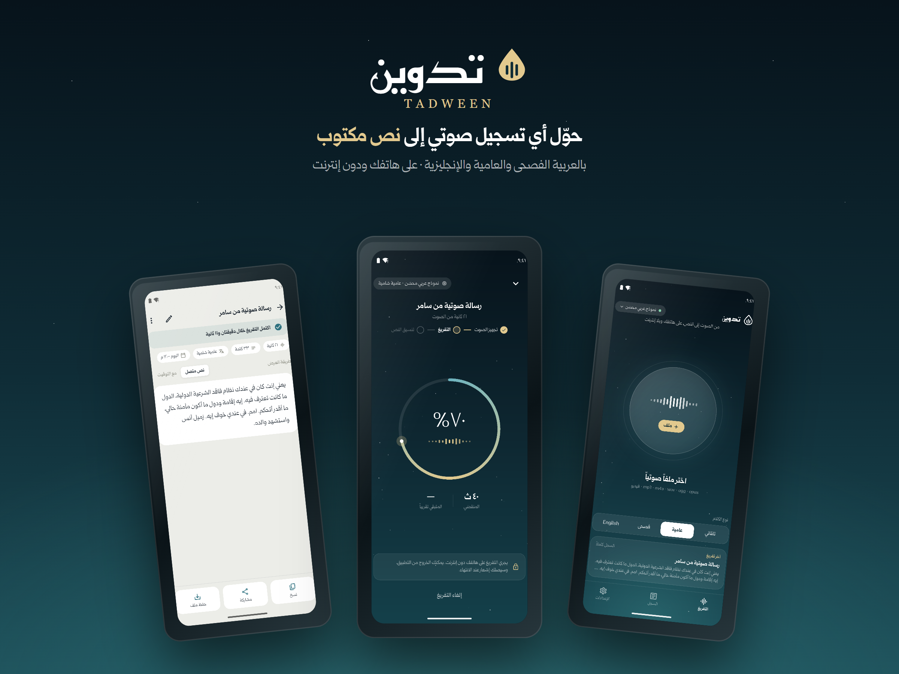

# تدوين — Tadween

تحويل الملفات الصوتية إلى نص بالعربية (الفصحى والعامية) والإنجليزية، على الهاتف ودون إنترنت.

## التنزيل
**[⬇ تنزيل أحدث إصدار (Tadween.apk)](https://github.com/AbdullahAlHallak/tadween-releases/releases/latest/download/Tadween.apk)**

للهواتف القديمة ذات معالج ٣٢-بت: [Tadween-old-phones.apk](https://github.com/AbdullahAlHallak/tadween-releases/releases/latest/download/Tadween-old-phones.apk)

> عند التثبيت قد يطلب أندرويد السماح بـ«التثبيت من مصادر غير معروفة» للمتصفح. بعدها تصلك التحديثات من داخل التطبيق.

